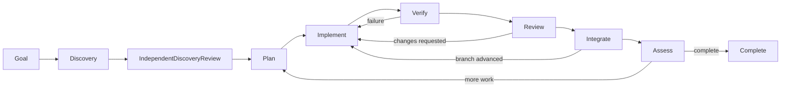

# Architecture

Dark Fabric is a single-host orchestrator around the official Codex app-server, Git and SQLite. It does not implement a replacement model loop or a quota bypass.

## Execution flow

Each task has its own durable phase and status. Product questions block only their task/dependents. Existing repositories may also use the research phase. Continuous missions assess progress in bounded batches; retrospectives produce bounded improvements that pass the same checks.

## Module map

| Module | Responsibility |
| --- | --- |
| cli.js / server.js | Local operator entry points and authenticated console |
| engine.js | Scheduling, execution, retries, limits and transitions |
| store.js / sqlite.js | SQLite schema, WAL, immediate transactions, leases and replay |
| codex.js | Official JSON-RPC app-server sessions, structured results, quota |
| agents.js / prompts.js | Host-owned agent profiles, routing and task context |
| git.js / quality.js / integrity.js | Worktrees, checkpoints, pins, accepted integration |
| process.js / process-host.js / executable.js | Child lifetime, workspace ownership and platform launch |
| lifecycle.js / scripts/supervisor.js / watchdog.js | Start/stop, persisted stop and supervised recovery |
| projects.js / portfolio.js / inputs.js | Project intake, fair scheduling and durable owner inputs |
| telemetry.js | Cumulative usage accounting and daily buckets |
| roadmap.js | Bounded project-independent text projection |
| remote.js / scripts/remote-worker.js | Optional outbound Sites bridge |
| contracts.js / blockers.js | Validated model results and question categories |

## Invariants

State changes and their durable receipts are transactional. SQLite uses WAL, full synchronization and a busy timeout. Write transactions reserve ownership before reading to avoid invalid WAL read-to-write upgrades. Nested operations use savepoints.

Execution is at least once. A lease prevents a stale worker from writing completion. A process owner holds the workspace lock until its Codex child exits; parent/stdio loss terminates the child tree. One writer per project is enforced independently of worker count.

A checkpoint is committed before host verification. The exact clean HEAD is checked again after verification and review. Integration is a replayable fast-forward. A changed base requires synchronization and renewed checks/review. Dirty mission worktrees are preserved for diagnosis.

The model cannot change trusted check commands, hashes, access policy, human answers or budgets through its result. Source documents and web research are untrusted data. Review uses a separate Codex session and source immutability checks.

## Limits and portability

The official app-server protocol can evolve. Doctor validates initialization and quota RPC; live smoke validates an actual task, verification, review and integration. Pin a tested CLI in a managed deployment and rerun live smoke before updates.

Runtime code and background launcher target Windows and macOS; CI also exercises Linux. Platform-specific project build tools remain the project's responsibility. The local console is a trusted single-user interface, not a multi-tenant boundary.

There is no hot self-replacement, distributed consensus, external exactly-once guarantee, automatic publication or deployment. Full execution access is an explicit operator choice, never a bundled grant.

See [official Codex app-server documentation](https://developers.openai.com/codex/app-server/) and [operations](operations.md).
